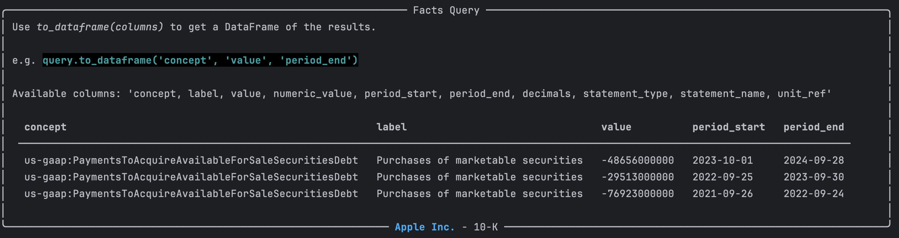

# Query XBRL Financial Facts from SEC Filings

You can query the facts inside an XBRL instance using the XBRL query API. This allows you to get access to specific financial data, filter results and perform analysis on the financial facts contained within a single XBRL filing.

## Overview

XBRL query functionality is built around two main classes:
- `FactsView` - Provides access to raw XBRL facts from a single filing
- `FactQuery` - Enables complex filtering and analysis of those facts

## Basic Usage

### Accessing Facts

```python
from edgar import *
from edgar.xbrl import XBRL

# Get an XBRL filing
company = Company("AAPL")
filing = company.latest("10-K")
xb = filing.xbrl()
```

### Access the facts view

The `FactsView` provides direct access to the facts in the XBRL instance:
```python
facts = xb.facts
print(f"Total facts: {len(facts)}")
```

## Querying Facts

To query facts use the `query()` method on the `XBRL` instance and one of the `by_` functions e.g. `by_text()`. This returns a `FactQuery` object that allows you to filter and manipulate the facts.

```python
# Start a query
results = (xb.query()
            .by_concept("us-gaap:PaymentsToAcquireAvailableForSaleSecuritiesDebt")
           )
```



The result is an `edgar.xbrl.facts.FactQuery` object that contains the filtered facts. You can see from the rich display the available columns of whichg a few are selected by default.

You can also convert the results to a DataFrame for easier manipulation including selecting which columns you want to view:

```python
df = results.to_dataframe('concept', 'label', 'value', 'period_end')
```

## Filtering Facts

### By Concept

You can filter facts by their concept names, which are unique identifiers for financial data items in XBRL.

```python
# Find revenue-related facts
revenue_query = xb.query().by_concept("us-gaap:Revenues")
```
The namespace e.g. `us-gaap:` is optional for the default partial match, so you can use just the concept name like `Revenues`.

Querying by concept does a partial regex match on the concept name

`by_concept('RevenueFrom')` matches `us-gaap:RevenueFromContractWithCustomerExcludingAssessedTax` and `us-gaap:RevenueFromContractWithCustomerTextBlock`

Use `exact=True` to match the full concept name exactly. An exact match needs the prefix: `by_concept('us-gaap:Assets', exact=True)` finds the filed concept, and `by_concept('Assets', exact=True)` returns no rows.

```python
assets = xb.query().by_concept("us-gaap:Assets", exact=True)
```


### By Label

You can filter facts by their labels, which are human-readable names associated with the concepts.
```python
# Search by label text
revenue_query = xb.query().by_label("Revenue")
```
To specify exact matches or partial matches, use the `exact` parameter:

```python
sales_query = xb.query().by_label("Revenue", exact=False)
```

### By Value

```python
# Facts with values above $1 billion
large_values = xb.query().by_value(lambda x: x > 1_000_000_000)

# Facts within a range
range_query = xb.query().by_value(lambda x: 100_000 <= x <= 1_000_000)
```


### By Period Keys

`by_period_keys()` captures the supplied keys when you call it. Appending,
removing or clearing items in your list later does not change that query's
selection, even if you have not executed the query yet. This applies to both
ordinary and stitched XBRL fact queries.

```python
period_keys = ["duration_2024-10-01_2025-03-31"]
query = xb.query().by_period_keys(period_keys)

period_keys.append("duration_2023-10-01_2024-03-31")
original_selection = query.to_dataframe()  # Still selects the first period
updated_selection = xb.query().by_period_keys(period_keys).to_dataframe()
```

Create a new query to use the edited selection. Calling `by_period_keys()`
again on the same query adds an AND constraint: a fact must satisfy both
selections. An empty list selects no facts, and duplicate keys do not duplicate
results or change their order. This capture rule applies to the built-in
period-list filter; custom predicates retain their own callable behavior.

Earlier implementations retained the caller's list without specifying when
the selection was captured. Editing the list could change `execute()` while
a cached DataFrame kept the previous selection. If your code used list edits
to update an existing query, create a new query as shown above. Clearing an
ordinary query's owner refreshes its source data while preserving the period
keys captured by that query.

### By Statement Type

```python
# Facts from specific statements
income_facts = xb.query().by_statement_type("IncomeStatement")
balance_facts = xb.query().by_statement_type("BalanceSheet")
```

## Method Chaining

Combine multiple filters using method chaining:

```python
# Complex query with multiple filters
complex_query = (xbrl.query()
                 .by_statement_type("IncomeStatement")
                 .by_label("Revenue")
                 .by_value(lambda x: x > 1_000_000)
                 .sort_by('value', ascending=False)
                 .limit(10))

results = complex_query.execute()
```

## Data Transformations

### Sorting

```python
# Sort by value (descending)
sorted_query = xbrl.query().sort_by('value', ascending=False)

# Sort by concept name
concept_sorted = xbrl.query().sort_by('concept')
```

### Limiting Results

```python
# Get top 10 results
top_10 = xbrl.query().limit(10)

# Pagination
page_1 = xbrl.query().limit(20)
page_2 = xbrl.query().offset(20).limit(20)
```

## Working with Results

### DataFrame Output

```python
# Get specific columns
df = query.to_dataframe('concept', 'label', 'value', 'period_end')

# All available columns
full_df = query.to_dataframe()

# Column information
print("Available columns:", df.columns.tolist())
```

### Refreshing cached query results

Ordinary and stitched queries share a cache lifecycle. Each cached conversion
belongs to the query's current configuration and requested columns; stitched
queries also include their period-filter settings. Returning to an earlier
configuration may reuse its cached DataFrame.

An ordinary `FactsView` caches enriched rows and its full DataFrame. It also owns
a cache generation, advanced by an explicit `clear_cache()` call. Call that method
on the query's own view when you need it to read updated data. Existing queries
bound to that view discard all prior-generation frames, including other column
projections, on the next `to_dataframe()` or `to_pandas()` call:

```python
view = xbrl.facts
query = view.query().by_concept("us-gaap:InterestPaidNet", exact=True)
earlier = query.to_dataframe()

# After updating the underlying data, explicitly clear this view.
view.clear_cache()
current = query.to_dataframe()
```

Clearing does not rewrite `earlier` or clear a separately constructed view, and
does not automatically refresh all XBRL statements or metadata. Stitched views
provide no cache generation: they retain configuration-only caching, with no
automatic source-refresh contract.

Sorting changes only the query's result list, never the owner's list, and does
not copy the row dictionaries. Cached conversions can return the same DataFrame
object; use `.copy()` before editing it if you need an independent frame.

### Fact Structure

Each fact contains the following key information:

```python
fact = results[0]
print(f"Concept: {fact['concept']}")
print(f"Label: {fact['label']}")
print(f"Value: {fact['value']}")
print(f"Period: {fact['period_end']}")
print(f"Units: {fact['units']}")
print(f"Decimals: {fact['decimals']}")
```

## Advanced Filtering

### Dimensions

```python
# Facts with specific dimensions
dimensional_query = xbrl.query().by_dimension("ProductOrServiceAxis", "ProductMember")

# Facts with any value for a dimension
any_product_dim = xbrl.query().by_dimension("ProductOrServiceAxis")

# Facts with NO dimensions (undimensioned facts)
undimensioned_facts = xbrl.query().by_dimension(None)

# Multiple dimensions: chain one by_dimension() per axis
multi_dim = (xbrl.query()
             .by_dimension("ProductOrServiceAxis", "ProductMember")
             .by_dimension("GeographyAxis", "USMember"))
```


## Performance Tips

1. **Use specific filters**: Filter early to reduce data processing
2. **Limit results**: Use `.limit()` for large datasets
3. **Cache queries**: Store frequently used queries
4. **Select columns**: Use `to_dataframe()` with specific columns

```python
# Efficient query pattern
efficient_query = (xb.query()
                   .by_statement_type("IncomeStatement")  # Filter first
                   .by_value(lambda x: x > 0)        # Remove zeros
                   .limit(100)                       # Limit results
                   .to_dataframe('concept', 'value')) # Select columns
```

## Examples

### Finding Revenue Information

```python
# All revenue-related facts
revenue_facts = (xb.query()
                 .by_label("revenue", exact=False)
                 .sort_by('value', ascending=False)
                 .execute())

for fact in revenue_facts:
    print(f"{fact['label']}: ${fact['value']:,}")
```

### Comparing Quarterly Data

```python
# Get quarterly revenue data
quarterly_revenue = (xb.query()
                     .by_concept("us-gaap:Revenues")
                     .by_period_type("duration")
                     .sort_by('period_end')
                     .to_dataframe('period_end', 'value'))

print(quarterly_revenue)
```

### Balance Sheet Analysis

```python
# Major balance sheet items
balance_items = (xb.query()
                 .by_statement_type("BalanceSheet")
                 .by_value(lambda x: x > 1_000_000_000)  # > $1B
                 .sort_by('value', ascending=False)
                 .to_dataframe('label', 'value'))

print("Major Balance Sheet Items (> $1B):")
print(balance_items)
```

This query system provides a flexible and powerful way to explore XBRL data, enabling detailed financial analysis and data extraction from individual filings.
